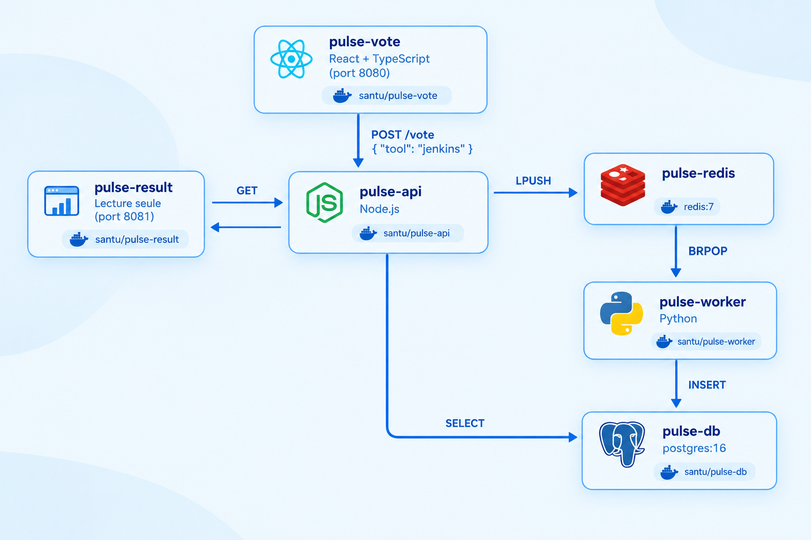

# Architecture du lab — Santu Pulse

> **Rôle de ce fichier** : vision d’ensemble du lab (infra, microservices, CI/CD, domaines, choix techniques).  
> **Pas ici** : commandes pour lancer / tester l’app → voir [`README.md`](./README.md).

Lab pédagogique DevOps autour de **Pulse** : votes publics sur des outils DevOps  
(`docker` · `ansible` · `kubernetes` · `linux` · `git` · `terraform` · `jenkins` · `aws`).

Le dépôt contient le code applicatif (`pulse/`), les manifests Kubernetes (`k8s-specifications/`) et des scripts d’installation (`setup/`).  
L’infra tourne sur **AWS Lightsail** (approche hub & spoke), avec **Jenkins** (CI), **Argo CD** (CD / GitOps), **Prometheus** et **Grafana** (observabilité).



---

## 1. Infra serveur (hub & spoke)

Instances **Lightsail** organisées en hub + cluster Kubernetes.

| Rôle              | Serveur(s)                   | Contenu                         |
| ----------------- | ---------------------------- | ------------------------------- |
| **Hub**           | serveur hub                  | Jenkins, Argo CD, Grafana       |
| **Control plane** | `k8s-cp1`                    | API Kubernetes + **Prometheus** |
| **Workers**       | `k8s-w1`, `k8s-w2`, `k8s-w3` | Workloads Pulse (pods)          |

```
                    ┌─────────────────────────────────┐
                    │            HUB                   │
                    │  Jenkins · Argo CD · Grafana     │
                    └──────────────┬──────────────────┘
                                   │
              ┌────────────────────┼────────────────────┐
              ▼                    ▼                    ▼
         k8s-cp1              k8s-w1 … w3
      (control plane          (workloads)
       + Prometheus)
```

### Domaines (Cloudflare)

| Domaine               | Service            |
| --------------------- | ------------------ |
| `jenkins.santu.io`    | Jenkins (CI)       |
| `argocd.santu.io`     | Argo CD (GitOps)   |
| `monitoring.santu.io` | Grafana            |
| `vote.santu.io`       | Frontend vote      |
| `result.santu.io`     | Frontend résultats |

---

## 2. Application Pulse (microservices)

Six composants. Quatre images custom + Redis / Postgres officiels.  
Chaque microservice applicatif a son **Dockerfile** et son **README**. Redis et Postgres n’ont **pas** de Dockerfile custom.

| Service       | Image Docker Hub (lab)     | Image locale (Compose) | Rôle                                    | Code / manifests                               |
| ------------- | -------------------------- | ---------------------- | --------------------------------------- | ---------------------------------------------- |
| **Vote UI**   | `aboubacar99/pulse-vote`   | `santu/pulse-vote`     | Interface de vote (React + nginx)       | `pulse/vote/` · `k8s-specifications/vote/`     |
| **Result UI** | `aboubacar99/pulse-result` | `santu/pulse-result`   | Affichage des scores (React + nginx)    | `pulse/result/` · `k8s-specifications/result/` |
| **API**       | `aboubacar99/pulse-api`    | `santu/pulse-api`      | REST : enqueue Redis + lecture Postgres | `pulse/api/` · `k8s-specifications/api/`       |
| **Worker**    | `aboubacar99/pulse-worker` | `santu/pulse-worker`   | Java 21 / Spring Boot : Redis → Postgres | `pulse/worker/` · `k8s-specifications/worker/` |
| **Redis**     | `redis:7-alpine`           | idem                   | File de votes (`votes`)                 | `k8s-specifications/redis/`                    |
| **Postgres**  | `postgres:16-alpine`       | idem                   | Persistance des votes                   | `k8s-specifications/db/`                       |

Stack locale de démo : `pulse/docker-compose.yml` — ports `8080` (vote), `8081` (result), `3000` (API debug). Voir [`README.md`](./README.md).

### Communication interne (DNS)

Toute la com. inter-services passe par les **noms DNS** (Service K8s ou service Compose) — pas d’URL externe :

| Qui → Qui               | Hostname DNS |
| ----------------------- | ------------ |
| vote / result → API     | `api`        |
| api / worker → Redis    | `redis`      |
| api / worker → Postgres | `db`         |

Les Services K8s s’appellent `api`, `redis`, `db`, `vote`, `result` — **mêmes noms** qu’en Compose.

```
Navigateur → vote | result (NodePort / domaines / ports exposés)
                ↓  nginx /api/
             Service "api" (ClusterIP) → redis · db
             Worker                    → redis · db
```

Le navigateur ne parle jamais directement à Redis, Postgres, le worker, ni (en K8s) à l’API.

### Flux de données (détail)

```
Navigateur
   │
   ├─► vote.santu.io  (NodePort 31000) ── nginx /api/ ──► api:3000
   │                                                      │
   └─► result.santu.io (NodePort 31001) ── nginx /api/ ──┤
                                                          │
                    api ── LPUSH ──► redis (file votes)
                    worker ── BRPOP ──► redis
                    worker / api ──► db (Postgres)
```

### Pourquoi l’API est en ClusterIP

Sur K8s, le Service `api` est de type **ClusterIP** : accessible **uniquement à l’intérieur** du cluster (`http://api:3000`).

- Le navigateur **ne peut pas** résoudre le DNS interne `api` — ce nom n’existe que dans le réseau du cluster.
- Si on exposait l’API en NodePort, il faudrait coller une URL publique (`IP:31002`, etc.) dans le frontend au build — contraire à une archi « services internes ».
- Avec ClusterIP + proxy nginx : seuls **vote** et **result** sont publiés (NodePort / domaines). L’API reste privée ; les frontends y accèdent **depuis le pod**, pas depuis Internet.

En Compose, le port `3000` peut rester mappé pour le debug local (`curl`) — ce n’est pas requis pour que les UIs fonctionnent.

### Rôle de `nginx.conf` (vote & result)

Les images vote/result sont des **SPA statiques** servies par nginx (`nginx.conf` + fichiers Vite `dist/`). nginx a **deux rôles** :

1. **Servir le frontend** — fichiers HTML/JS/CSS, `try_files` pour le routing React, endpoint `/healthz`.
2. **Proxy reverse `/api` → `http://api:3000`** — le JS appelle `/api/vote`, `/api/results`, etc. sur le **même host** que l’UI. nginx, **dans** le réseau Docker/K8s, relaie vers le Service DNS `api`.

Sans ce proxy, le navigateur devrait appeler l’API avec une URL externe — impossible avec une API ClusterIP.

### Exposition côté cluster

| Service        | Type               | Port            |
| -------------- | ------------------ | --------------- |
| `vote`         | NodePort           | `31000`         |
| `result`       | NodePort           | `31001`         |
| `api`          | ClusterIP          | `3000`          |
| `redis` / `db` | ClusterIP          | `6379` / `5432` |
| `worker`       | — (pas de Service) | —               |

Le worker n’a **pas** de Service K8s (process interne uniquement, comme *example-voting-app*).

---

## 3. CI — Jenkins

Jenkins (sur le **hub**) gère le build & push des images.

1. Push du code sur **GitHub**.
2. Webhook déclenche les jobs.
3. Chaque service a son **Jenkinsfile** : `pulse/api`, `pulse/vote`, `pulse/result`, `pulse/worker`.
4. Le stage `Build` ne s’exécute que si le **changeset** touche le dossier du service (`changeset 'pulse/api/**'`, etc.) — ou en cas de tag (`buildingTag()`).
5. Build Docker + push sur **Docker Hub** : `aboubacar99/pulse-<service>:$GIT_COMMIT`.

Credential Jenkins utilisé : `docker-hub`.

---

## 4. CD / GitOps — Argo CD

Argo CD (sur le **hub**) est connecté au cluster (`k8s-cp1` + workers).

- Source de vérité : le dossier **`k8s-specifications/`** du dépôt.
- Contenu : un Deployment (+ Service si besoin) par composant : `api`, `worker`, `vote`, `result`, `redis`, `db`.
- Quand les manifests changent (nouvelle image taguée avec le commit, etc.), Argo CD synchronise le cluster.

### Chaîne de bout en bout

```
Dev → push GitHub
        → Jenkins (changeset) → build & push Docker Hub
        → maj k8s-specifications (tag image)
        → Argo CD sync → pods sur k8s-w*
        → vote.santu.io / result.santu.io
```

Déploiement manuel (`kubectl apply`) possible aussi — commandes dans [`README.md`](./README.md).

---

## 5. Observabilité

| Outil          | Où                          | Rôle                                    |
| -------------- | --------------------------- | --------------------------------------- |
| **Prometheus** | `k8s-cp1`                   | Collecte de métriques du cluster / apps |
| **Grafana**    | hub (`monitoring.santu.io`) | Dashboards                              |

---

## 6. Structure du dépôt

```
microservices/
├── explication_de_larchitecture_du_lab.md   ← ce fichier (vision lab)
├── README.md                                ← mode d’emploi (lancer / tester)
├── Pulse_Vote_Microservices_Architecture.png
├── pulse/                                   ← code applicatif
│   ├── docker-compose.yml                   # stack locale (style voting-app)
│   ├── api/          # Node.js + Dockerfile + Jenkinsfile + README
│   ├── worker/       # Java 21 + Spring Boot + Dockerfile + Jenkinsfile + README
│   ├── vote/         # React/TS + nginx + Dockerfile + Jenkinsfile + README
│   └── result/       # React/TS + nginx + Dockerfile + Jenkinsfile + README
├── k8s-specifications/                      ← manifests GitOps (Argo CD)
│   ├── api/ · worker/ · vote/ · result/
│   ├── redis/ · db/
├── setup/                                   ← bootstrap lab
│   ├── vm-install-script/                   # kubeadm, Docker, Jenkins…
│   └── jenkins-plugins/                     # liste / install plugins Jenkins
└── .kube/                                   ← kubeconfig local (non versionné)
```

Pour le détail produit, API et commandes locales : voir [`README.md`](./README.md).
